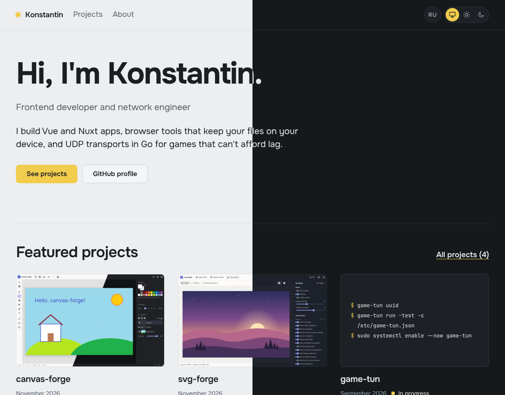

# konst-dev

[Русская версия](README.ru.md)

[](https://github.com/it2konst/konst-dev/actions/workflows/ci.yml)

**Live: [konst-dev.vercel.app](https://konst-dev.vercel.app)**

My portfolio site, built with Nuxt 4. Each project is one JSON file in the repository: commit the file, and the site rebuilds with a new card, a project page and both languages. No CMS, no database, no admin panel.



> **In progress.** The home page and projects are done: featured projects, the list with a filter by technology and a page for every project. The About page arrives in the next stage of the [roadmap](#roadmap).

## Features

- The home page headline assembles like UDP traffic: letters arrive out of order, lit in the accent color, and settle into the sentence. Pure CSS with delays computed at build time, so it plays before any script loads; screen readers get the plain sentence, and with reduced motion the text just appears
- Featured projects on the home page come from the same JSON files (`"featured": true`), and two short blocks about the work link to the project list filtered by Vue or Go
- Projects are data: one JSON file per project, both languages in the same file, checked against a schema at build time
- A typo in a technology name, a missing translation or a bad date fails the build with a clear message instead of reaching the site
- The project list: newest first, a screenshot, date and status, a summary, the stack, and links to the demo and the code
- Projects without a user interface show the commands to run them in a terminal block
- A page for every project: summary, demo and code buttons, a large screenshot, what's inside, the stack, and links to the newer and older project
- Filter by technology with a count for each; the filter is part of the address (`/projects?stack=pwa`), so a filtered list can be shared, and stack tags on project pages lead straight to it
- Screenshots are converted at build time to AVIF with a WebP fallback, in the widths each layout needs: three covers weigh 24 KB on a regular screen
- Every project page is pre-rendered in both languages, and a broken internal link fails the build
- Static site: every page is pre-rendered to HTML, so it loads fast and hosts anywhere
- English at `/` and Russian at `/ru`, each page with its own address, a canonical link and hreflang alternates for search engines
- The first visit follows the browser language; after that the choice is kept
- The language link opens the same page in the other language, not the home page
- Light, dark and system themes; the theme is applied before the first paint, so pages never flash
- Design tokens in two layers: a raw SCSS palette and semantic CSS custom properties that components use
- Every text color passes WCAG AA on every surface in both themes, and a test keeps it that way
- No pure white or black, softened contrast for long reading
- Fonts (Onest and JetBrains Mono) are bundled with the site: no requests to font CDNs
- Keyboard friendly: a skip link, visible focus everywhere, toggle buttons that announce their state
- Respects reduced motion
- Responsive down to phone width; on phones the navigation gets its own row instead of a hidden menu
- Localized 404 and error pages

## Tech stack

| Area            | Tools                                                    |
| --------------- | -------------------------------------------------------- |
| Framework       | Nuxt 4, Vue 3, TypeScript (strict)                       |
| Rendering       | Static generation with `nuxt generate`, hosted on Vercel |
| Styles          | SCSS, design tokens as CSS custom properties, no UI kit  |
| Content         | Nuxt Content 3 on Node's built-in SQLite, Zod schemas    |
| Images          | @nuxt/image with IPX: AVIF and WebP at build time        |
| Localization    | @nuxtjs/i18n                                             |
| Themes          | @nuxtjs/color-mode                                       |
| Fonts           | @fontsource-variable/onest, jetbrains-mono               |
| Quality         | ESLint (@nuxt/eslint), Prettier, vue-tsc                 |
| Tests           | Vitest, @nuxt/test-utils, happy-dom                      |
| CI              | GitHub Actions                                           |
| Package manager | pnpm                                                     |

## Getting started

Requires Node.js 22 or newer and pnpm 10.

```bash
pnpm install
pnpm dev
```

The dev server runs at http://localhost:3000.

| Script              | What it does                                     |
| ------------------- | ------------------------------------------------ |
| `pnpm dev`          | Start the dev server                             |
| `pnpm generate`     | Build the static site into `.output/public`      |
| `pnpm preview`      | Serve the built site locally                     |
| `pnpm check:assets` | Check that every file the built pages use exists |
| `pnpm build`        | Build for a Node server (not used for hosting)   |
| `pnpm lint`         | Lint and auto-fix                                |
| `pnpm lint:check`   | Lint without changing files                      |
| `pnpm format`       | Format the project with Prettier                 |
| `pnpm format:check` | Check formatting                                 |
| `pnpm type-check`   | Run vue-tsc through `nuxt typecheck`             |
| `pnpm test`         | Run all tests once                               |
| `pnpm test:watch`   | Run tests on every change                        |

## Adding a project

1. Put a screenshot in `public/projects/<slug>/`, for example `cover.webp`. 16:10 works best; 1440×900 WebP is a good size.
2. Create `content/projects/<slug>.json`. The file name becomes the project's address, so use lowercase letters, digits and hyphens.
3. Run `pnpm test`: it checks the file against the schema and tells you exactly what is missing. Then commit.

The project page at `/projects/<slug>` and `/ru/projects/<slug>`, the card in the list and the filter options appear on their own. Smaller copies of the screenshot in AVIF and WebP are made during the build, so commit only the original.

```json
{
  "name": "svg-forge",
  "date": "2026-11",
  "status": "live",
  "featured": true,
  "summary": { "en": "One or two sentences.", "ru": "Одно-два предложения." },
  "highlights": {
    "en": ["What is notable inside", "Up to six points"],
    "ru": ["Что интересного внутри", "До шести пунктов"]
  },
  "stack": ["vue", "typescript", "svgo"],
  "links": {
    "repo": "https://github.com/it2konst/svg-forge",
    "demo": "https://svg-forge-two.vercel.app"
  },
  "cover": {
    "src": "/projects/svg-forge/cover.webp",
    "alt": { "en": "What the screenshot shows", "ru": "Что на скриншоте" }
  }
}
```

| Field        | Required | What it is                                                                           |
| ------------ | -------- | ------------------------------------------------------------------------------------ |
| `name`       | yes      | Display name, usually the repository name                                            |
| `date`       | yes      | Release or last major update as `YYYY-MM`; the list is sorted newest first           |
| `status`     | yes      | `live`, `in-progress` or `archived`; the last two get a label                        |
| `featured`   | yes      | Shown on the home page                                                               |
| `summary`    | yes      | One or two sentences in English and Russian                                          |
| `highlights` | yes      | Up to six points per language, the same number in both                               |
| `stack`      | yes      | Ids from [`shared/utils/stack.ts`](shared/utils/stack.ts); add a new one there first |
| `links`      | yes      | `repo` on GitHub; `demo` is required for live projects with a user interface         |
| `cover`      | one of   | Screenshot path and its description in both languages                                |
| `terminal`   | one of   | Up to five commands, shown instead of a screenshot for projects without a UI         |

### Deploying

The site is static: deploy the output of `pnpm generate`. On Vercel, `vercel.json` sets this as the build command. Vercel's default for Nuxt is `nuxt build`, which renders some pages on a server, and screenshots for those pages would never be generated.

### Site address

Canonical and hreflang links need the public address of the site. It defaults to `https://konst-dev.vercel.app`; to use another one, set `NUXT_PUBLIC_SITE_URL` in the hosting settings.

## Tests

Tests run with Vitest locally and on every push in GitHub Actions, together with lint, formatting, type-check and the static build. After the build, `pnpm check:assets` goes through every page and fails if an image or file it refers to is missing from the output.

- **Design tokens:** the test reads the SCSS token files and checks every text color against every surface in both themes for WCAG AA contrast, plus text on the accent fill and in the terminal block. Change the palette in a way that hurts readability, and CI fails.
- **Project files:** every file in `content/projects` is checked against the schema, plus the rules that span fields or the file system: a cover or a terminal block, a demo link for live projects with an interface, a URL-safe file name, the cover present on disk. The schema itself is tested with broken examples.
- **Headline:** every character kept in order and grouped by word, delays within range and the same on every run, letters out of order but settling from the start.
- **Filter:** counting and sorting technologies, filtering, and reading `?stack=` from the address, including unknown ids and repeated parameters.
- **Translations:** English and Russian have the same keys, no empty strings and no long dashes.
- **Components**, mounted in a real Nuxt app: the theme switch marks one option as pressed and changes the theme; the language link points to the same page in the other language; the project card with a cover and with a terminal, its links to the project page and their names for screen readers; the filter buttons, their pressed state and clearing; stack tags that link to the filtered list; the headline's screen reader text; project tiles; terminal commands that wrap only between words.

## Project structure

```text
app/
  assets/styles/
    tokens/      raw palette, semantic colors, type, space, radius, motion
    base/        reset, typography, buttons, page blocks, utilities
    _mixins.scss breakpoints and helpers, available in every component
  components/
    home/        the animated headline
    layout/      header and footer
    project/     card, tile, picture, date line, stack tags and filter, terminal block
    ui/          theme switch, language link
  composables/   head tags, project queries, picking the language from content
  layouts/       page frame with the skip link
  utils/         the letter order for the headline
  pages/         home, projects and a page per project, about
  error.vue      404 and error page
content/projects/  one JSON file per project
public/projects/   project screenshots
shared/
  schema/        the project schema, used by Nuxt Content and the tests
  utils/         the list of technologies a project can use, filter helpers
i18n/locales/    English and Russian messages
test/
  unit/          project files, schema, filter, headline, tokens and translations
  nuxt/          components inside Nuxt
```

## Roadmap

1. ~~Shell: tooling, design tokens, themes, EN/RU, layout, tests and CI~~ ✓
2. ~~Projects as data: a typed Nuxt Content collection, one JSON file per project, the project list~~ ✓
3. ~~Project pages and filters: a page per project, filtering by stack, optimized images~~ ✓
4. ~~Home page: the hero and featured projects~~ ✓
5. About and contacts: experience, skills, links
6. SEO and sharing: Open Graph images, sitemap, favicon
7. Polish: motion, an accessibility pass, Lighthouse, deploy guide

## Author

Made by [it2konst](https://github.com/it2konst). Issues and suggestions are welcome in [GitHub Issues](https://github.com/it2konst/konst-dev/issues).

## License

[MIT](LICENSE)
