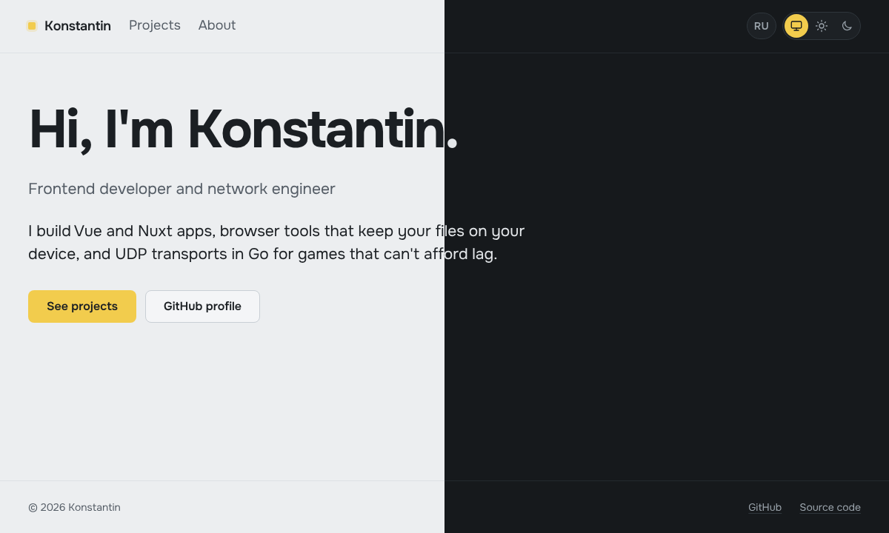

# konst-dev

[English version](README.md)

[](https://github.com/it2konst/konst-dev/actions/workflows/ci.yml)

Мой сайт-портфолио на Nuxt 4. Каждый проект хранится в репозитории как один JSON-файл: закоммитил файл, и сайт пересобирается с новой карточкой, страницей проекта и сразу на двух языках. Без CMS, базы данных и админки.



> **В разработке.** Каркас готов: design tokens, светлая и тёмная темы, английский и русский языки, раскладка, тесты и CI. Проекты появятся на следующем этапе [плана](#план).

## Возможности

- Статический сайт: каждая страница заранее собрана в HTML, поэтому быстро загружается и размещается на любом хостинге
- Английский по адресу `/`, русский по `/ru`: у каждой страницы свой адрес, канонический URL и ссылки hreflang для поисковиков
- При первом визите язык выбирается по браузеру, дальше выбор запоминается
- Ссылка смены языка открывает ту же страницу на другом языке, а не главную
- Светлая, тёмная и системная темы; тема применяется до первой отрисовки, поэтому страница не мигает
- Design tokens в два слоя: исходная палитра в SCSS и семантические CSS-переменные, которыми пользуются компоненты
- Каждый цвет текста проходит WCAG AA на любой поверхности в обеих темах, и это проверяет тест
- Нет чистого белого и чёрного, мягкий контраст для долгого чтения
- Шрифты (Onest и JetBrains Mono) лежат в самом сайте: никаких запросов к сторонним серверам шрифтов
- Удобно с клавиатуры: ссылка «Перейти к содержимому», видимый фокус везде, кнопки сообщают своё состояние
- Учитывает настройку «уменьшить движение»
- Адаптивная вёрстка до ширины телефона; на телефоне навигация занимает отдельную строку, а не прячется в меню
- Страницы 404 и ошибок на обоих языках

## Технологии

| Область          | Инструменты                                                 |
| ---------------- | ----------------------------------------------------------- |
| Фреймворк        | Nuxt 4, Vue 3, TypeScript (strict)                          |
| Рендеринг        | Статическая сборка через `nuxt generate`, хостинг на Vercel |
| Стили            | SCSS, design tokens в CSS-переменных, без UI-библиотеки     |
| Локализация      | @nuxtjs/i18n                                                |
| Темы             | @nuxtjs/color-mode                                          |
| Шрифты           | @fontsource-variable/onest, jetbrains-mono                  |
| Качество кода    | ESLint (@nuxt/eslint), Prettier, vue-tsc                    |
| Тесты            | Vitest, @nuxt/test-utils, happy-dom                         |
| CI               | GitHub Actions                                              |
| Менеджер пакетов | pnpm                                                        |

## Запуск

Нужны Node.js 22 или новее и pnpm 10.

```bash
pnpm install
pnpm dev
```

Сайт откроется по адресу http://localhost:3000.

| Скрипт              | Что делает                                     |
| ------------------- | ---------------------------------------------- |
| `pnpm dev`          | Запустить сервер разработки                    |
| `pnpm generate`     | Собрать статический сайт в `.output/public`    |
| `pnpm preview`      | Открыть собранный сайт локально                |
| `pnpm build`        | Сборка под Node-сервер (для хостинга не нужна) |
| `pnpm lint`         | Проверить линтером и исправить                 |
| `pnpm lint:check`   | Проверить линтером без изменений               |
| `pnpm format`       | Отформатировать проект через Prettier          |
| `pnpm format:check` | Проверить форматирование                       |
| `pnpm type-check`   | Проверить типы через `nuxt typecheck`          |
| `pnpm test`         | Запустить все тесты один раз                   |
| `pnpm test:watch`   | Запускать тесты при каждом изменении           |

### Адрес сайта

Для канонических ссылок и hreflang нужен публичный адрес сайта. По умолчанию это `https://konst-dev.vercel.app`; чтобы указать другой, задайте `NUXT_PUBLIC_SITE_URL` в настройках хостинга.

## Тесты

Тесты запускаются через Vitest локально и при каждом push в GitHub Actions, вместе с линтером, проверкой форматирования, типов и статической сборкой.

- **Design tokens:** тест читает SCSS-файлы токенов и проверяет каждый цвет текста на каждой поверхности в обеих темах на контраст WCAG AA, а также текст на акцентной заливке. Если поменять палитру так, что текст станет хуже читаться, CI упадёт.
- **Переводы:** в английском и русском одинаковые ключи, нет пустых строк и длинных тире.
- **Компоненты** монтируются в настоящем Nuxt-приложении: переключатель темы отмечает ровно один вариант и меняет тему; ссылка смены языка ведёт на ту же страницу на другом языке.

## Структура проекта

```text
app/
  assets/styles/
    tokens/      палитра, семантические цвета, шрифты, отступы, радиусы, анимации
    base/        сброс стилей, типографика, кнопки, блоки страниц, утилиты
    _mixins.scss брейкпоинты и помощники, доступны в каждом компоненте
  components/
    layout/      шапка и подвал
    ui/          переключатель темы, ссылка смены языка
  composables/   общие теги head: заголовок, описание, hreflang
  layouts/       каркас страницы со ссылкой «Перейти к содержимому»
  pages/         главная, проекты, обо мне
  error.vue      страница 404 и ошибок
i18n/locales/    тексты на английском и русском
test/
  unit/          токены и переводы
  nuxt/          компоненты внутри Nuxt
```

## План

1. ~~Каркас: инструменты, design tokens, темы, EN/RU, раскладка, тесты и CI~~ ✓
2. Проекты как данные: типизированная коллекция Nuxt Content, один JSON-файл на проект, сетка проектов
3. Страницы проектов и фильтры: страница на каждый проект со скриншотами и описанием, фильтр по стеку, оптимизация картинок
4. Главная: первый экран и избранные проекты
5. Обо мне и контакты: опыт, навыки, ссылки
6. SEO и превью ссылок: картинки Open Graph, sitemap, favicon
7. Шлифовка: анимации, проверка доступности, Lighthouse, инструкция по деплою

## Автор

Сделал [it2konst](https://github.com/it2konst). Предложения и сообщения об ошибках жду в [GitHub Issues](https://github.com/it2konst/konst-dev/issues).

## Лицензия

[MIT](LICENSE)
