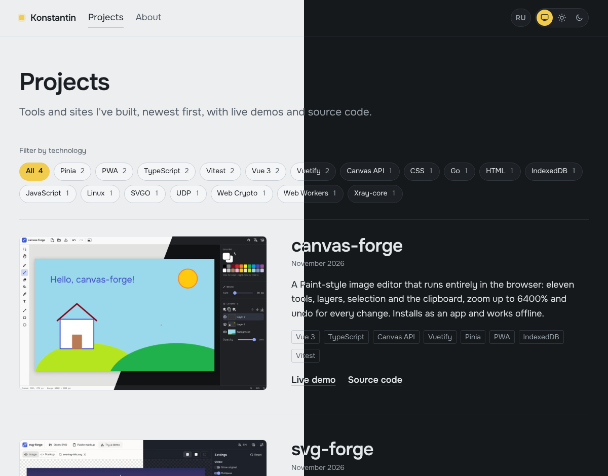

# konst-dev

[English version](README.md)

[](https://github.com/it2konst/konst-dev/actions/workflows/ci.yml)

**Сайт: [konst-dev.vercel.app](https://konst-dev.vercel.app)**

Мой сайт-портфолио на Nuxt 4. Каждый проект хранится в репозитории как один JSON-файл: закоммитил файл, и сайт пересобирается с новой карточкой, страницей проекта и сразу на двух языках. Без CMS, базы данных и админки.



> **В разработке.** Раздел проектов готов: список с фильтром по технологиям и отдельная страница для каждого проекта. Главная с избранными проектами появится на следующем этапе [плана](#план).

## Возможности

- Проекты как данные: один JSON-файл на проект, оба языка в одном файле, проверка по схеме при сборке
- Опечатка в названии технологии, пропущенный перевод или неверная дата роняют сборку с понятным сообщением, а не попадают на сайт
- Список проектов: от новых к старым, скриншот, дата и статус, описание, стек, ссылки на демо и код
- У проектов без графического интерфейса вместо скриншота показаны команды запуска в блоке терминала
- Отдельная страница для каждого проекта: описание, кнопки демо и кода, большой скриншот, что внутри, стек и ссылки на проект новее и проект раньше
- Фильтр по технологиям со счётчиком у каждой; фильтр хранится в адресе (`/projects?stack=pwa`), поэтому отфильтрованным списком можно поделиться, а плашки стека на странице проекта ведут прямо в него
- Скриншоты при сборке превращаются в AVIF с запасным WebP, в тех размерах, которые нужны каждой раскладке: три обложки весят 24 КБ на обычном экране
- Каждая страница проекта заранее собирается на обоих языках, а битая внутренняя ссылка роняет сборку
- Статический сайт: каждая страница заранее собрана в HTML, поэтому быстро загружается и размещается на любом хостинге
- Английский по адресу `/`, русский по `/ru`: у каждой страницы свой адрес, канонический URL и ссылки hreflang для поисковиков
- При первом визите язык выбирается по браузеру, дальше выбор запоминается
- Ссылка смены языка открывает ту же страницу на другом языке, а не главную
- Светлая, тёмная и системная темы; тема применяется до первой отрисовки, поэтому страница не мигает
- Design tokens в два слоя: исходная палитра в SCSS и семантические CSS-переменные, которыми пользуются компоненты
- Каждый цвет текста проходит WCAG AA на любой поверхности в обеих темах, и это проверяет тест
- Нет чистого белого и чёрного, мягкий контраст для долгого чтения
- Шрифты (Onest и JetBrains Mono) лежат в самом сайте: никаких запросов к сторонним серверам шрифтов
- Удобно с клавиатуры: ссылка «Перейти к содержимому», видимый фокус везде, кнопки сообщают своё состояние
- Учитывает настройку «уменьшить движение»
- Адаптивная вёрстка до ширины телефона; на телефоне навигация занимает отдельную строку, а не прячется в меню
- Страницы 404 и ошибок на обоих языках

## Технологии

| Область          | Инструменты                                                 |
| ---------------- | ----------------------------------------------------------- |
| Фреймворк        | Nuxt 4, Vue 3, TypeScript (strict)                          |
| Рендеринг        | Статическая сборка через `nuxt generate`, хостинг на Vercel |
| Стили            | SCSS, design tokens в CSS-переменных, без UI-библиотеки     |
| Контент          | Nuxt Content 3 на встроенном SQLite из Node, схемы на Zod   |
| Картинки         | @nuxt/image с IPX: AVIF и WebP при сборке                   |
| Локализация      | @nuxtjs/i18n                                                |
| Темы             | @nuxtjs/color-mode                                          |
| Шрифты           | @fontsource-variable/onest, jetbrains-mono                  |
| Качество кода    | ESLint (@nuxt/eslint), Prettier, vue-tsc                    |
| Тесты            | Vitest, @nuxt/test-utils, happy-dom                         |
| CI               | GitHub Actions                                              |
| Менеджер пакетов | pnpm                                                        |

## Запуск

Нужны Node.js 22 или новее и pnpm 10.

```bash
pnpm install
pnpm dev
```

Сайт откроется по адресу http://localhost:3000.

| Скрипт              | Что делает                                     |
| ------------------- | ---------------------------------------------- |
| `pnpm dev`          | Запустить сервер разработки                    |
| `pnpm generate`     | Собрать статический сайт в `.output/public`    |
| `pnpm preview`      | Открыть собранный сайт локально                |
| `pnpm build`        | Сборка под Node-сервер (для хостинга не нужна) |
| `pnpm lint`         | Проверить линтером и исправить                 |
| `pnpm lint:check`   | Проверить линтером без изменений               |
| `pnpm format`       | Отформатировать проект через Prettier          |
| `pnpm format:check` | Проверить форматирование                       |
| `pnpm type-check`   | Проверить типы через `nuxt typecheck`          |
| `pnpm test`         | Запустить все тесты один раз                   |
| `pnpm test:watch`   | Запускать тесты при каждом изменении           |

## Как добавить проект

1. Положите скриншот в `public/projects/<slug>/`, например `cover.webp`. Лучше всего пропорции 16:10; хороший размер: WebP 1440×900.
2. Создайте `content/projects/<slug>.json`. Имя файла станет адресом проекта, поэтому только строчные латинские буквы, цифры и дефисы.
3. Запустите `pnpm test`: тест проверит файл по схеме и точно скажет, чего не хватает. Потом коммит.

Страница проекта по адресам `/projects/<slug>` и `/ru/projects/<slug>`, карточка в списке и пункт в фильтре появятся сами. Уменьшенные копии скриншота в AVIF и WebP делаются при сборке, так что коммитить нужно только оригинал.

```json
{
  "name": "svg-forge",
  "date": "2026-11",
  "status": "live",
  "featured": true,
  "summary": { "en": "One or two sentences.", "ru": "Одно-два предложения." },
  "highlights": {
    "en": ["What is notable inside", "Up to six points"],
    "ru": ["Что интересного внутри", "До шести пунктов"]
  },
  "stack": ["vue", "typescript", "svgo"],
  "links": {
    "repo": "https://github.com/it2konst/svg-forge",
    "demo": "https://svg-forge-two.vercel.app"
  },
  "cover": {
    "src": "/projects/svg-forge/cover.webp",
    "alt": { "en": "What the screenshot shows", "ru": "Что на скриншоте" }
  }
}
```

| Поле         | Обязательное | Что это                                                                                        |
| ------------ | ------------ | ---------------------------------------------------------------------------------------------- |
| `name`       | да           | Название, обычно имя репозитория                                                               |
| `date`       | да           | Релиз или последнее крупное обновление в формате `YYYY-MM`; список идёт от новых к старым      |
| `status`     | да           | `live`, `in-progress` или `archived`; у двух последних есть метка                              |
| `featured`   | да           | Показывать на главной                                                                          |
| `summary`    | да           | Одно-два предложения на английском и русском                                                   |
| `highlights` | да           | До шести пунктов на каждом языке, поровну в обоих                                              |
| `stack`      | да           | Id из [`shared/utils/stack.ts`](shared/utils/stack.ts); новую технологию сначала добавьте туда |
| `links`      | да           | `repo` на GitHub; `demo` обязателен для живых проектов с интерфейсом                           |
| `cover`      | одно из двух | Путь к скриншоту и его описание на обоих языках                                                |
| `terminal`   | одно из двух | До пяти команд, показываются вместо скриншота у проектов без интерфейса                        |

### Адрес сайта

Для канонических ссылок и hreflang нужен публичный адрес сайта. По умолчанию это `https://konst-dev.vercel.app`; чтобы указать другой, задайте `NUXT_PUBLIC_SITE_URL` в настройках хостинга.

## Тесты

Тесты запускаются через Vitest локально и при каждом push в GitHub Actions, вместе с линтером, проверкой форматирования, типов и статической сборкой.

- **Design tokens:** тест читает SCSS-файлы токенов и проверяет каждый цвет текста на каждой поверхности в обеих темах на контраст WCAG AA, а также текст на акцентной заливке и в блоке терминала. Если поменять палитру так, что текст станет хуже читаться, CI упадёт.
- **Файлы проектов:** каждый файл в `content/projects` проверяется по схеме и по правилам, которые касаются нескольких полей или файлов: есть скриншот или блок терминала, есть демо у живого проекта с интерфейсом, безопасное для адреса имя файла, скриншот лежит на диске. Сама схема проверяется на заведомо неправильных примерах.
- **Фильтр:** подсчёт и сортировка технологий, фильтрация и чтение `?stack=` из адреса, включая неизвестные id и повторённые параметры.
- **Переводы:** в английском и русском одинаковые ключи, нет пустых строк и длинных тире.
- **Компоненты** монтируются в настоящем Nuxt-приложении: переключатель темы отмечает ровно один вариант и меняет тему; ссылка смены языка ведёт на ту же страницу на другом языке; карточка проекта со скриншотом и с терминалом, её ссылки на страницу проекта и их названия для скринридеров; кнопки фильтра, их нажатое состояние и сброс; плашки стека со ссылками на отфильтрованный список.

## Структура проекта

```text
app/
  assets/styles/
    tokens/      палитра, семантические цвета, шрифты, отступы, радиусы, анимации
    base/        сброс стилей, типографика, кнопки, блоки страниц, утилиты
    _mixins.scss брейкпоинты и помощники, доступны в каждом компоненте
  components/
    layout/      шапка и подвал
    project/     карточка, картинка, строка с датой, плашки стека и фильтр, блок терминала
    ui/          переключатель темы, ссылка смены языка
  composables/   теги head, запросы проектов, выбор языка из контента
  layouts/       каркас страницы со ссылкой «Перейти к содержимому»
  pages/         главная, проекты и страница каждого проекта, обо мне
  error.vue      страница 404 и ошибок
content/projects/  по одному JSON-файлу на проект
public/projects/   скриншоты проектов
shared/
  schema/        схема проекта, её используют Nuxt Content и тесты
  utils/         список технологий, которые может указать проект, функции фильтра
i18n/locales/    тексты на английском и русском
test/
  unit/          файлы проектов, схема, фильтр, токены и переводы
  nuxt/          компоненты внутри Nuxt
```

## План

1. ~~Каркас: инструменты, design tokens, темы, EN/RU, раскладка, тесты и CI~~ ✓
2. ~~Проекты как данные: типизированная коллекция Nuxt Content, один JSON-файл на проект, список проектов~~ ✓
3. ~~Страницы проектов и фильтры: страница на каждый проект, фильтр по стеку, оптимизация картинок~~ ✓
4. Главная: первый экран и избранные проекты
5. Обо мне и контакты: опыт, навыки, ссылки
6. SEO и превью ссылок: картинки Open Graph, sitemap, favicon
7. Шлифовка: анимации, проверка доступности, Lighthouse, инструкция по деплою

## Автор

Сделал [it2konst](https://github.com/it2konst). Предложения и сообщения об ошибках жду в [GitHub Issues](https://github.com/it2konst/konst-dev/issues).

## Лицензия

[MIT](LICENSE)
